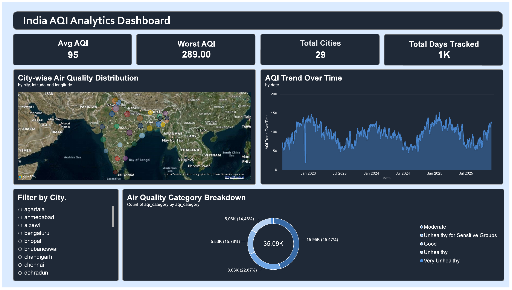
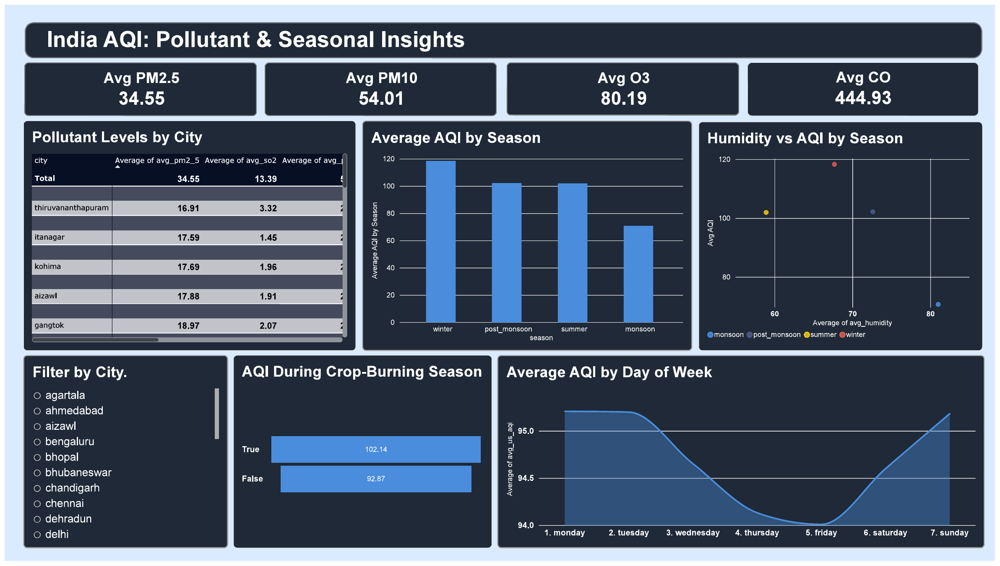

# India AQI Analytics Dashboard (Power BI)

An interactive two-page Power BI dashboard that analyses daily air quality across **29 Indian cities**. It covers overall AQI trends, the air quality category mix, pollutant levels by city, seasonal patterns, crop-burning impact and day-of-week behaviour.

This is the capstone project for my Postgraduate Program in Data Science and Analytics with GenAI at Imarticus Learning.

## Dashboard Preview

**Page 1: India AQI Analytics Dashboard**



**Page 2: Pollutant & Seasonal Insights**



## Objective

To understand how air quality varies across Indian cities and over time, which pollutants and seasons drive poor air quality, and whether crop-burning periods make a measurable difference.

## Key Metrics

| Metric | Value |
|---|---|
| Average AQI | 95 |
| Worst AQI recorded | 289 |
| Cities covered | 29 |
| Records analysed | ~35K daily city readings |
| Avg PM2.5 | 34.55 |
| Avg PM10 | 54.01 |
| Avg O3 | 80.19 |
| Avg CO | 444.93 |

## Key Insights

- **Winter is the most polluted season** (average AQI of about 118), while **monsoon is the cleanest** (about 71), as rain washes pollutants out of the air.
- **Crop-burning periods are worse**: average AQI of **102.14** during crop-burning season versus **92.87** outside it.
- **AQI moves in a narrow band across the week** (roughly 94 to 95), with Monday and Sunday slightly higher and Friday the lowest.
- **AQI shows a seasonal cycle** from 2023 to 2025, with peaks around winter months and dips around monsoon.
- **The city map and city filter** let you compare locations. Cleaner cities such as Thiruvananthapuram, Itanagar, Kohima and Aizawl show much lower PM2.5 (about 17 to 19) than the national average of 34.55.

## Dashboard Pages

**Page 1: India AQI Analytics**
- KPI cards: Average AQI, Worst AQI, Total Cities, Total Days Tracked
- City-wise air quality distribution map
- AQI trend over time
- Air quality category breakdown (Good, Moderate, Unhealthy for Sensitive Groups, Unhealthy, Very Unhealthy)
- City filter slicer

**Page 2: Pollutant & Seasonal Insights**
- KPI cards: Average PM2.5, PM10, O3, CO
- Pollutant levels by city (table)
- Average AQI by season
- Humidity vs AQI by season
- AQI during crop-burning season
- Average AQI by day of week
- City filter slicer

## Tools Used

- **Power BI Desktop**: data modelling, DAX measures, interactive visuals
- **Excel**: source dataset

## Data Source

The dataset (`data/aqi_india_daily.xlsx`) was sourced from [Kaggle](https://www.kaggle.com/) and contains daily AQI and pollutant readings for Indian cities.

## Repository Structure

```
AQI-Analytics-Dashboard-PowerBI/
├── README.md
├── dashboard/
│   ├── AQI_Dashboard.pbix      # Power BI file (open in Power BI Desktop)
│   └── AQI_Dashboard.pdf       # Exported dashboard pages
├── data/
│   └── aqi_india_daily.xlsx    # Daily AQI and pollutant data by city
└── screenshots/
    ├── page1_india_aqi_analytics.png
    └── page2_pollutant_seasonal_insights.png
```

## How to Open

1. Download `dashboard/AQI_Dashboard.pbix`.
2. Open it in [Power BI Desktop](https://powerbi.microsoft.com/desktop/) (free).
3. If prompted, point the data source to `data/aqi_india_daily.xlsx`.

## Author

**Ganesh Kurup**
BSc IT graduate | Aspiring Data Analyst
[LinkedIn](https://linkedin.com/in/ganesh-kurup-713b54433) | [GitHub](https://github.com/ganeshkurup19)
